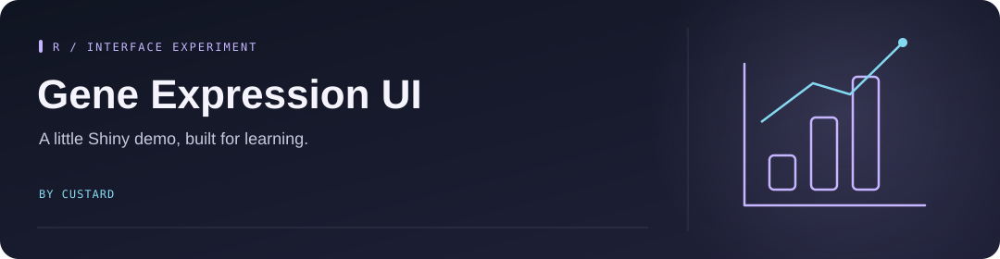

<!-- Project artwork created for this repository. -->
<p align="center">
  
</p>

<h1 align="center">Gene Expression UI</h1>

<p align="center">
  
</p>

**A small R Shiny prototype for exploring a classifier interface.**

<p align="center"><a href="#what-it-shows">What it shows</a> &nbsp; · &nbsp; <a href="#open-the-demo">Open the demo</a></p>

## What it shows

Choose a number of genes and click **Build Classifier** to display a sample plot and score.

**Both outputs are random placeholders.** The repository contains no gene-expression dataset, trained classifier, or real PCA calculation. It demonstrates the interface, not a biological result.

## Open the demo

Install R and an editor that supports R Markdown, then install the packages:

```r
install.packages(c("shiny", "flexdashboard", "rmarkdown", "knitr"))
```

Open [shinyapp.io.Rmd](shinyapp.io.Rmd) and run its chunks, including the final `shinyApp(ui = ui, server = server)` call. The source credits the original notebook author as Yiping.
